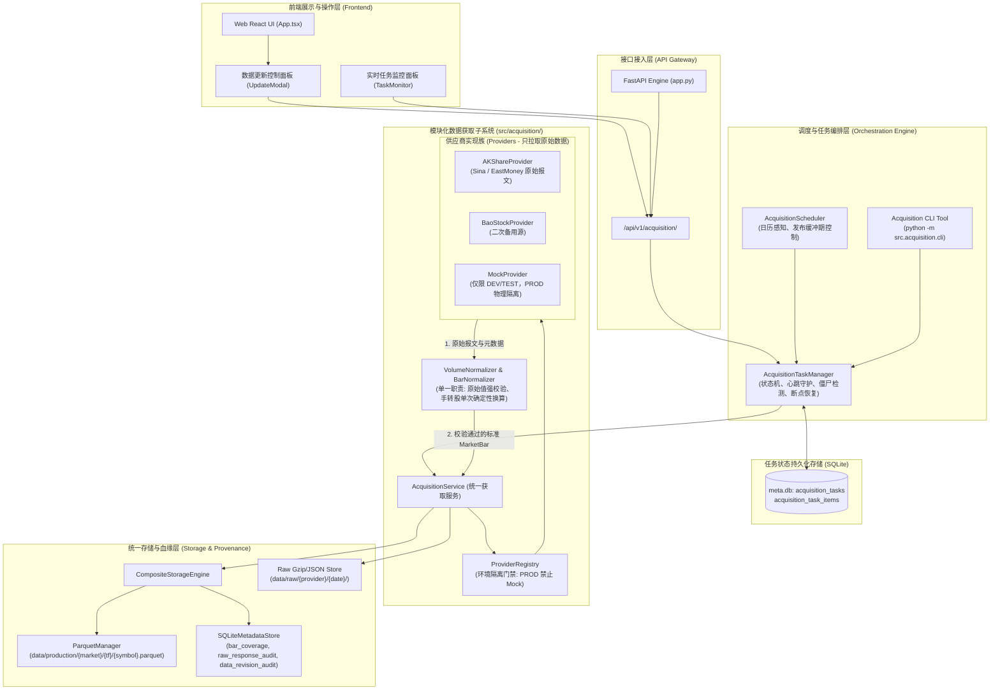

# MIE_V0.70 — Modular Data Acquisition Architecture Specification

**Document ID**: `MIE-STEP7-ARCH-001`  
**Version**: `MIE_V0.70`  
**Status**: `APPROVED / ENHANCED WITH USER DIRECTIVES`  
**Authors**: Antigravity Core Architectural Team  

---

## 1. 架构目标与设计原则 (Architectural Goals & Principles)

### 1.1 背景与痛点
在 `MIE_V0.60` 及之前版本中，数据获取逻辑存在以下架构痛点：
1. **耦合严重**: 数据抓取（AKShare）、数据存储（Parquet/SQLite）与业务逻辑交织，无统一的任务抽象。
2. **缺乏独立运行能力**: 无法作为独立的 CLI 工具或后台守护进程独立执行增量更新与断点抓取。
3. **主备与量纲黑盒**: 东财与新浪的接口差异（如手 vs 股）、接口故障降级缺乏全局归一化层。
4. **任务状态易失**: 任务状态仅保存在内存中，重启后丢失；无心跳导致僵尸任务无法感知。
5. **扩展与环境安全**: 增加新数据源困难，且缺乏 Mock 数据与生产环境的严格物理隔离。

### 1.2 核心设计原则 (Design Principles & User Directives)
- **绝对解耦 (Strict Decoupling)**: 核心分析引擎 (`analysis`)、指标库 (`indicators`) 与预测模型 (`models`) 仅依赖标准化实体 `MarketBar` 和统一存储接口 `CompositeStorageEngine`，绝不直接引用任何具体数据供应商。
- **职责单一化 (Single Responsibility Principle - Directive 2)**:
  - **Provider 纯粹化**: Provider 仅负责外部接口调用、原始报文提取、通信重试与状态元数据记录。**Provider 严禁包含任何清洗、量纲转换或业务过滤逻辑**。
  - **Normalizer 集中化**: 所有数据格式化、量纲换算（手转股）、VWAP 真实性校验与 `MarketBar` 实体构建，**100% 由 `VolumeNormalizer` / `BarNormalizer` 单独负责**。
- **成交量单次确定性转换与原始值强校验 (Directive 4)**:
  - 成交量转换具有幂等性，转换且仅转换一次，严禁重复乘算。
  - 转换前必须对原始报文的 `raw_volume`、`raw_amount` 与 `close` 执行 VWAP 合理性校验，确保证据链完整。
- **生产环境严禁 Mock (Directive 3)**:
  - `MockProvider` 实施严格的运行环境隔离，仅当配置明确为测试/开发环境且 `MIE_ALLOW_MOCK_DATA=true` 时方可激活；在 `production` 环境下注册中心直接拒绝加载，任何调用请求均强制阻断。
- **任务状态持久化、心跳与僵尸任务检测 (Directive 1)**:
  - 任务状态由内存提升至 SQLite（`acquisition_tasks` 与 `acquisition_task_items` 表）持久化，进程崩溃/重启不丢失任务进度。
  - 任务执行器维持心跳更新（`last_heartbeat_at`）。系统启动与巡检时自动检测并标记超时未更新的僵尸任务（Zombie Tasks）。
- **超时分片、断点续传与期限设计 (Directive 5)**:
  - 严格执行“单任务执行不超过 20 分钟”规约。
  - 批量任务按标的细粒度分片，记录子任务状态。遭遇意外中止时，支持断点续传（`--resume`），自动跳过已成功的标的。
- **行情发布缓冲调度 (Directive 7)**:
  - 充分考虑交易所与行情源的清算与发布延迟，定时收盘调度加入配置化缓冲期（默认收盘后延迟 45~60 分钟，如 15:45 后触发），确保获取到稳定最终数据。

---

## 2. 整体系统架构图 (System Architecture)



---

## 3. 核心子系统与职责划分 (Subsystem Responsibilities)

### 3.1 供应商抽象与注册中心 (`src/acquisition/providers/`)
1. **`BaseProvider` 接口契约**:
   - `fetch_raw_bars(symbol, timeframe, start, end) -> RawProviderResponse`:
     仅返回原始数据字典/DataFrame、原始响应文本、调用的接口标识（`source_interface`）、网络耗时及原始量纲单位声明（`VolumeUnit.LOT` 或 `VolumeUnit.SHARE`）。
   - `check_health() -> bool`
   - `supported_markets() -> list[Market]`
2. **`ProviderRegistry` 注册中心**:
   - 维护 Provider 实例字典。
   - **生产环境门禁隔离**: 检查 `settings.ENVIRONMENT` 与 `settings.ALLOW_MOCK_DATA`，若为生产环境，禁止注册或返回 `MockProvider`。

### 3.2 量纲归一化与原始值强校验 (`src/acquisition/normalizer.py`)
- **单一职责**: 作为系统内唯一允许执行量纲转换和数据清洗的模块。
- **单次确定性转换与原始值校验**:
  1. **原始值校验**: 验证 `raw_volume >= 0`、`close > 0`。若存在 `amount`，计算估算 VWAP `est_vwap = amount / raw_volume`。若原始单位为手，估算 VWAP 约为 `close * 100`；若原始单位为股，估算 VWAP 约为 `close`。通过比率校验原始单位声明与数据实际分布的一致性。
  2. **单次转换**: 
     - 若 `raw_volume_unit == VolumeUnit.LOT`：`normalized_volume = raw_volume * 100.0`。
     - 若 `raw_volume_unit == VolumeUnit.SHARE`：`normalized_volume = raw_volume * 1.0`。
     - 输出明确标记 `is_normalized=True`，后续流程绝不重复转换。
  3. **输出构造**: 生成带 SHA-256 Checksum 的标准 `MarketBar` 实体。

### 3.3 任务状态机、心跳与僵尸任务治理 (`src/acquisition/task_manager.py`)
- **SQLite 状态持久化**:
  - `acquisition_tasks`: 记录主任务 ID、参数、总体状态、总量、已完成数、失败数、创建时间、开始时间、完成时间、最后心跳时间 (`last_heartbeat_at`)。
  - `acquisition_task_items`: 记录单个标的子任务状态（`PENDING`, `RUNNING`, `SUCCESS`, `FAILED`）、行数、耗时、重试次数、错误信息。
- **心跳守护 (Heartbeat)**:
  - 任务执行期间，Worker 协程每隔 5 秒刷新主任务的 `last_heartbeat_at`。
- **僵尸任务检测与恢复 (Zombie Detection & Recovery)**:
  - 在服务启动或定时巡检时，扫描处于 `RUNNING` 状态但 `last_heartbeat_at < now - 120s` 的任务。
  - 自动将其标记为 `INTERRUPTED` 或 `FAILED`，释放资源。
- **断点续传支持 (Resume)**:
  - 支持传入 `task_id` 执行 resume，自动查询该任务下仍处于 `PENDING` 或 `FAILED` 的标的子项继续执行，已 `SUCCESS` 的标的直接跳过。

---

## 4. 双模运行与调度设计 (Dual-Mode & Scheduler Design)

### 4.1 独立 CLI 模式
```bash
# 抓取单只标的
python -m src.acquisition.cli fetch --symbol 600519.SH --start 2023-01-01 --end 2023-12-31

# 批量抓取（带断点持久化与 20 分钟超时守卫）
python -m src.acquisition.cli batch --symbols 600519.SH,000858.SZ,300750.SZ --timeframe 1d

# 断点恢复上次未完成的任务
python -m src.acquisition.cli resume --task-id acq_20261115_a8f9c1

# 僵尸任务巡检清理
python -m src.acquisition.cli cleanup-zombies
```

### 4.2 定时调度器的行情发布缓冲 (Directive 7)
- A 股 15:00 闭市后，上交所/深交所及主流数据源需要时间完成清算汇总。
- 调度器配置默认缓冲 `market_close_buffer_minutes = 45`。
- 定时更新任务在交易日 15:45 或 16:00 触发，避免在 15:01 抓取到未结算完成的临时分时汇总统数据。
